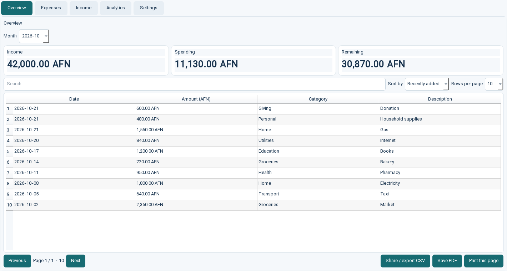

# Personal Expense Tracker

A Python and Streamlit application for recording expenses, managing categories, and reviewing spending trends. Records are stored in MySQL or MariaDB.

## Features

- Add, update, and delete expenses
- Reuse categories already present in your expense history or create a new one
- Review totals, category spending, monthly trends, and a selectable date range
- Use the Streamlit interface or the optional command-line interface

## Requirements

- Python 3.10 or newer
- MySQL 8 or MariaDB 10.4 or newer
- A database user permitted to create/read/update/delete records in expense_tracker

## Setup

1. Clone or download this repository and open a terminal in its folder.
2. Create and activate a virtual environment:

   ~~~powershell
   py -m venv .venv
   .venv\Scripts\Activate.ps1
   ~~~

3. Install dependencies:

   ~~~powershell
   python -m pip install -r requirements.txt
   ~~~

4. Create the database and table. For a fresh database, import expenses.sql with your MySQL/MariaDB client. The dump contains example rows; remove its INSERT INTO expenses section first if you want an empty database. Alternatively, create the schema manually:

   ~~~sql
   CREATE DATABASE expense_tracker CHARACTER SET utf8mb4;
   USE expense_tracker;
   CREATE TABLE expenses (
       id INT NOT NULL AUTO_INCREMENT PRIMARY KEY,
       amount DECIMAL(10, 2) NOT NULL,
       date DATE NOT NULL,
       reason VARCHAR(100),
       category VARCHAR(40) NOT NULL
   );
   ~~~

5. Configure the database connection in your environment before starting the app:

   ~~~powershell
   $env:EXPENSE_DB_HOST = "localhost"
   $env:EXPENSE_DB_PORT = "3306"
   $env:EXPENSE_DB_USER = "expense_app"
   $env:EXPENSE_DB_PASSWORD = "your-local-password"
   $env:EXPENSE_DB_NAME = "expense_tracker"
   ~~~

   The app defaults to localhost, port 3306, user root, and database expense_tracker for compatibility with a local development setup. Set a password through EXPENSE_DB_PASSWORD; do not store credentials in source code or commit a .env file. Use a dedicated database account rather than a privileged account when possible.

6. Launch the web app:

   ~~~powershell
   streamlit run app.py
   ~~~

   To use the command-line version instead, run python main.py.

## Validation and tests

Run the automated unit tests with Python's built-in test runner:

~~~powershell
python -m unittest discover -s tests -v
~~~

The suite also works with pytest if you prefer. It covers input/date validation and database transaction behavior using mocks, so no running database is needed.

## Screenshots

To add screenshots for GitHub, create a screenshots/ folder and save clear images of the Overview, Analytics, and Manage Expenses screens there. Embed committed images in this README with relative Markdown paths such as . Do not include real personal expense data, passwords, connection strings, or other private information in screenshots.

## Troubleshooting

- **Connection refused or timed out:** Start MySQL/MariaDB and confirm the host and port environment variables.
- **Access denied:** Check the configured username, password, and database grants.
- **Unknown database/table:** Create expense_tracker and import expenses.sql, or create the table with the schema above.
- **Tests fail to import dependencies:** Activate the virtual environment and install requirements.txt.

## Repository readiness

.gitignore excludes the virtual environment, Python cache files, and .env files. Keep secrets in local environment variables or a secrets manager, and review git status before publishing.
