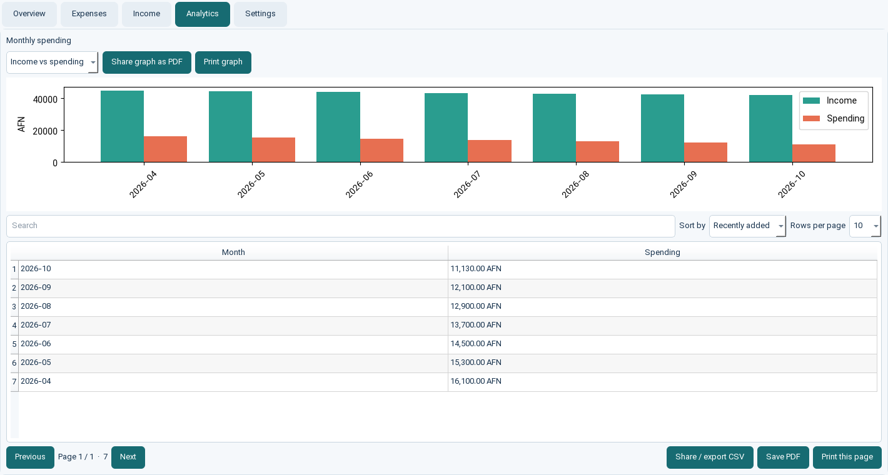
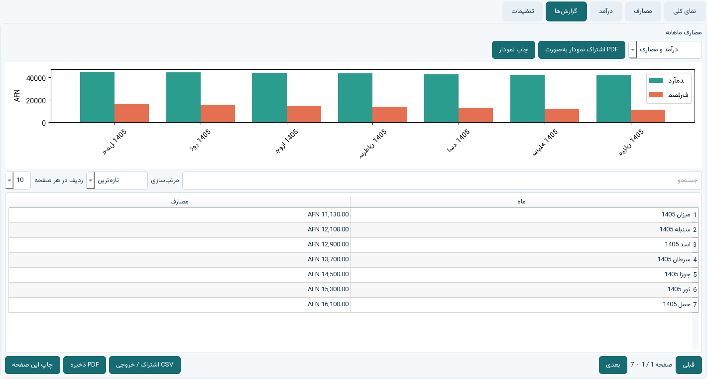
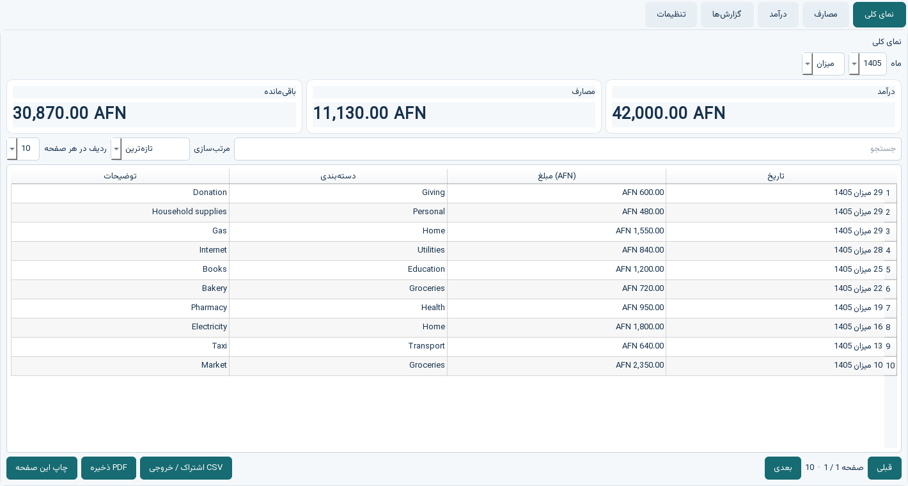

<div align="center">


# Expense Tracker

**Know what came in, what went out, and what remains.**

An offline-first expense and income tracker for Windows, with English, Dari, AFN, and the Afghan Solar Hijri calendar.

[Download for Windows](https://github.com/HomafarSharifi/expense-tracker/releases/latest) · [Report a problem](https://github.com/HomafarSharifi/expense-tracker/issues) · [Explore the source](#for-developers-and-cli-users)


</div>

---

## Your money, at a glance

Record income and spending, see the month’s remaining balance, and understand where money goes. Records stay on your computer; the app does not need a MySQL server, a cloud account, or an internet connection for daily use.

### Made for everyday use

- **Simple setup:** install the Windows app and open it. No separate Python or database installation.
- **Income and expenses:** track salary and other income alongside day-to-day spending.
- **Monthly overview:** compare income, spending, remaining balance, and category totals.
- **Find records quickly:** search, choose a page size, and sort by newest, oldest, highest amount, or lowest amount.
- **English or Dari:** switch language and choose Gregorian or Afghan Solar Hijri dates.
- **Take your information with you:** create a backup, export tables, print a report, or save a PDF.
- **Works offline:** data is stored locally in a SQLite database under your Windows user profile.

> **Windows download:** [Get the latest Setup.exe](https://github.com/HomafarSharifi/expense-tracker/releases/latest). Choose the `ExpenseTracker-Setup-...-x64.exe` file under **Assets**. The setup is per-user and does not require administrator access.

### First launch

1. Download and run the latest Windows setup file from [Releases](https://github.com/HomafarSharifi/expense-tracker/releases).
2. If Windows displays a SmartScreen message, check that the file came from this repository’s Releases page. This project’s installer is not code-signed yet, so Windows may show a warning for a new download.
3. Open **Expense Tracker** from the Start menu, choose your language and calendar in **Settings**, then add income or an expense.
4. Use **Overview** to follow the current month. Use the table controls to change sorting, page size, and page.

### Bring data from the previous MySQL version

Keep the old MySQL database running while migrating. From this project folder, run the one-time, read-only exporter below. It needs the old database credentials and `mysql-connector-python`; MySQL is not a dependency of the new app. It asks for the password without displaying it, reads the two old tables, and writes a private JSON file. Install the new app, open **Settings → Restore backup**, and select that file. Restore works only for a new, empty profile so existing records are not overwritten by accident.

```powershell
python -m pip install mysql-connector-python
python tools\migrate_mysql_v1.py --output .\legacy-backup.json
```

The exporter defaults to `localhost:3306` and `expense_tracker`. Use `--host`, `--port`, `--user`, or `--database` if your old setup differs. Do not publish or commit the resulting JSON backup.

### A quick look

These screenshots come from the running desktop interface and use fictional sample records.

<div align="center">








</div>

---

## For developers and CLI users

The project has two entry points:

| Use | Entry point | Dependencies |
| --- | --- | --- |
| Desktop app | `python app.py` | PySide6 and Matplotlib |
| CLI | `python main.py` | Python standard library only |

### Run the CLI

Python 3.10 or later is required. The CLI and SQLite storage use only the Python standard library.

```powershell
git clone https://github.com/HomafarSharifi/expense-tracker.git
cd expense-tracker
python main.py --help
python main.py add 125.50 2026-10-21 Groceries "Weekly food"
python main.py income 42000 2026-10 Salary
python main.py summary --month 2026-10
python main.py list --page 1 --limit 20 --sort recent
```

`--db path\to\file.sqlite3` selects a database file for scripts and isolated testing. Without it, the CLI uses the same local user profile database as the desktop app.

### Run the desktop app from source

```powershell
py -3.11 -m venv .venv
.venv\Scripts\Activate.ps1
python -m pip install -r requirements.txt
python app.py
```

### Test and build

```powershell
python -m unittest discover -s tests -v
```

To build the Windows application folder, run PowerShell on Windows and install [Inno Setup](https://jrsoftware.org/isinfo.php) if you also want to create the installer:

```powershell
Set-ExecutionPolicy -Scope Process Bypass
.\build_windows.ps1
```

Then open `installer\ExpenseTracker.iss` in Inno Setup and compile it. The resulting installer is written to `release\`. GitHub Actions also builds a Windows setup package when a version tag such as `v2.0.0` is published.

### Data and privacy notes

- The database is stored at `%LOCALAPPDATA%\ExpenseTracker\expenses.sqlite3` by default. The CLI and desktop app use the same data.
- Nothing is sent to a server, and there is no analytics or telemetry.
- Database and JSON backup files are **not encrypted by the app**. Anyone with access to your Windows account may be able to read them. Use a protected Windows account and device encryption such as BitLocker where available; store backups privately.
- CSV exports neutralize spreadsheet formula text. PDF and CSV files are created only when you choose an export location.
- Backups can contain sensitive financial details. Restore validates the file and refuses to overwrite a non-empty profile.
- This is a portfolio project and is not financial, tax, or banking software. Keep an independent backup of important records.

The Dari interface bundles [Vazirmatn](https://github.com/rastikerdar/vazirmatn), licensed under the [SIL Open Font License 1.1](assets/fonts/OFL.txt). The main application source is licensed under MIT.

### Project layout

```text
app.py                    Desktop application entry point
main.py                   CLI entry point
expense_tracker/storage.py SQLite schema, validation, data access, backup/restore
expense_tracker/desktop.py PySide6 interface, charts, print and export controls
expense_tracker/cli.py     Command-line workflows
jalali_calendar.py        Afghan Solar Hijri conversion helpers
tests/                    Automated storage, migration, reports, calendar, and UI checks
installer/                Inno Setup definition for the Windows installer
```

### Contributing and feedback

Bug reports and practical feedback are welcome through [GitHub Issues](https://github.com/HomafarSharifi/expense-tracker/issues). Please do not attach a real database or backup file; use fictional sample data when reporting a problem.

---

<div align="center">

Built as a portfolio project for people who want a clear, local way to track everyday money.

</div>
